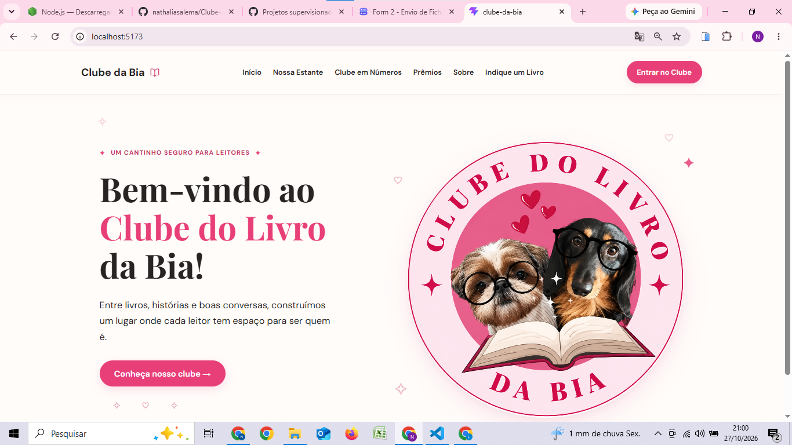
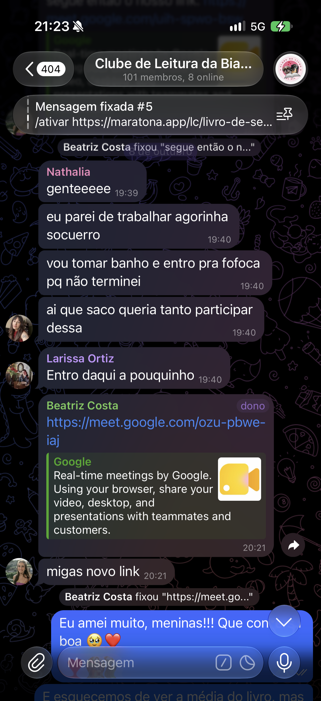
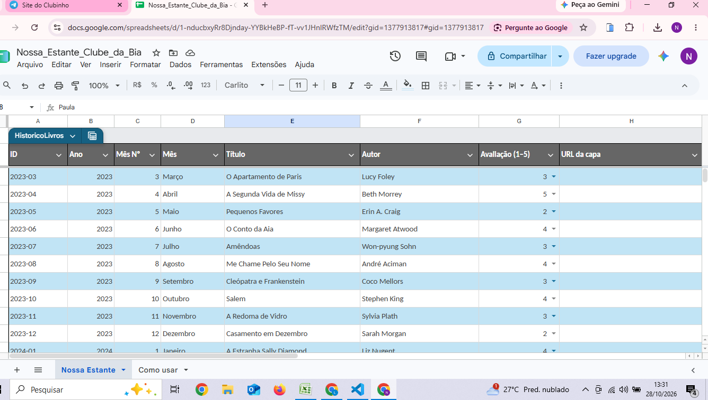
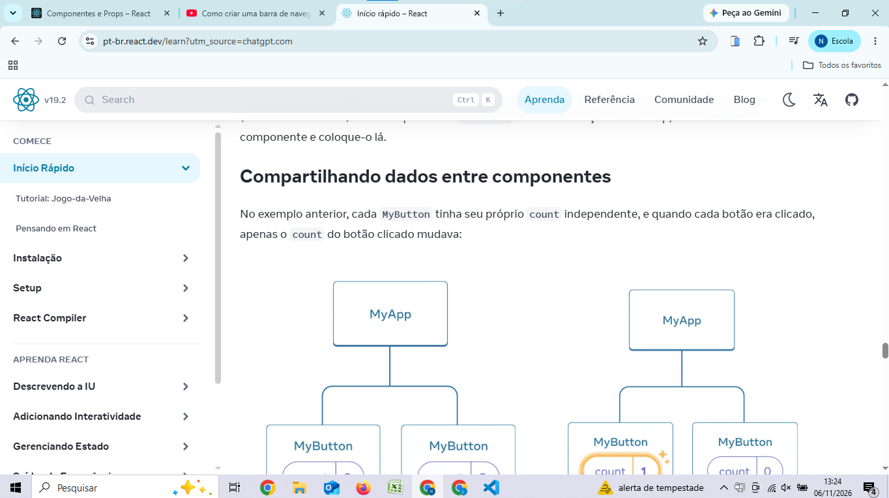
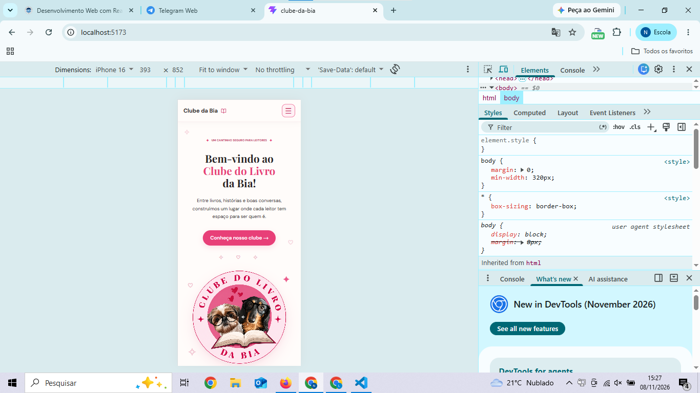
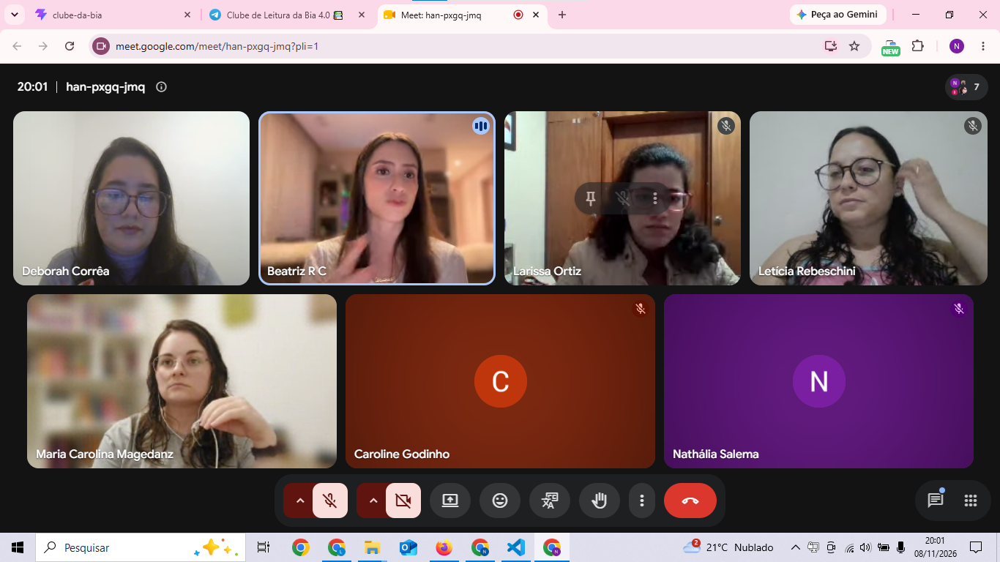

# TIMESHEET (Registro de Horas) — PROJETO SUPERVISIONADO DE EXTENSÃO

**Aluno:** Nathália Salema Quintanilha  
**Projeto:** Clube do Livro da Bia

> Registre as atividades conforme forem realizadas.
> Cada atividade deve ter uma evidência correspondente no índice.

## Registro de atividades

| Etapa | Data Início | Data Fim | Horas | Atividade realizada | Encontro c/ cliente? | Evidências (link) | Responsável | Comentários |
|---|---|---|---:|---|:---:|---|---|---|
| Requisitos | 08/10/2026 | 08/10/2026 | 2 | Encontro com Beatriz Costa e participantes do clube para levantamento das necessidades do site. | S | [Evidência 03 — Encontro com a comunidade](evidencias/encontro-clube-08-10.png) | Nathália Salema Quintanilha | Alinhamento dos objetivos do projeto com a cliente e a comunidade. |
| Planejamento/design | 27/10/2026 | 27/10/2026 | 1 | Definição da identidade visual, paleta de cores, tipografia e organização da página inicial. | N | [Evidência 01 — Interface inicial](evidencias/home-clube-bia.png) | Nathália Salema Quintanilha | Planejamento visual da aplicação. |
| Desenvolvimento | 27/10/2026 | 27/10/2026 | 5 | Desenvolvimento da página inicial e do cabeçalho com React, Vite e CSS, incluindo logo, textos e elementos visuais. | N | [Evidência 02 — Commit no GitHub](https://github.com/nathaliasalema/Clube-da-Bia/commit/184c749f90cef6ecaab97df978aef04a41996c7c) | Nathália Salema Quintanilha | Implementação da interface inicial e verificação visual no navegador. |
| Desenvolvimento | 28/10/2026 | 28/10/2026 | 5 | Levantamento do histórico de leituras e criação de uma planilha com os dados dos livros do clube. | N | [Evidência 04 — Planilha de livros](evidencias/planilha.png) | Nathália Salema Quintanilha | Organização inicial de 34 livros de 2023 a 2025. |
| Planejamento/design | 06/11/2026 | 06/11/2026 | 2 | Estudo da documentação oficial do React sobre componentes, props e organização da interface. | N | [Evidência 05 — Estudo de React](evidencias/estudo-react-06-11.png) | Nathália Salema Quintanilha | Preparação para o desenvolvimento da página Nossa Estante. |
| Desenvolvimento | 06/11/2026 | 06/11/2026 | 8 | Criação da página Nossa Estante, configuração do React Router, componentes de livros, filtros por ano e integração com Google Sheets via CSV e Papa Parse. | N | [Evidência 06 — Desenvolvimento da Nossa Estante](https://github.com/nathaliasalema/Clube-da-Bia/commit/0fe07ba50f01ef551d03344210c611e64bb02a89) | Nathália Salema Quintanilha | Atualização dos registros e capas, estilização, ajustes de responsividade e verificações de funcionamento. |
| Planejamento/design | 06/11/2026 | 06/11/2026 | 1 | Elaboração do PLANEJAMENTO.md com prioridades, funcionalidades previstas e tarefas das próximas etapas. | N | [Evidência 07 — Planejamento das próximas etapas](PLANEJAMENTO.md) | Nathália Salema Quintanilha | Conclusão da jornada de 11 horas do dia, distribuídas entre estudo (2h), desenvolvimento (8h) e planejamento (1h). |
| Desenvolvimento | 08/11/2026 | 08/11/2026 | 1,5 | Implementação do menu hambúrguer responsivo com React e CSS, reorganização dos estilos e adaptação da navegação para dispositivos móveis. | N | [Evidência 08 — Menu responsivo](evidencias/menu-responsivo-08-11.png) | Nathália Salema Quintanilha | Cabeçalho adaptado para celulares e tablets, preservando a versão para computadores. |
| Testes | 08/11/2026 | 08/11/2026 | 0,5 | Testes de abertura e fechamento do menu, navegação entre páginas e visualização em diferentes tamanhos de tela. | N | [Evidência 08 — Menu responsivo](evidencias/menu-responsivo-08-11.png) | Nathália Salema Quintanilha | Funcionamento e responsividade verificados no navegador. |
| Desenvolvimento | 08/11/2026 | 08/11/2026 | 6 | Desenvolvimento da página Sobre, incluindo a história do clube, explicação do funcionamento, informações sobre Beatriz Costa, vídeos incorporados e links para redes sociais. Experimentação de diferentes layouts, ajustes de cores, tipografia, espaçamentos e cards até alcançar o resultado desejado. Tentativa de implementação de um carrossel de vídeos, posteriormente adiada após dificuldades técnicas. | N | [Evidência 09 — Página Sobre](https://github.com/nathaliasalema/Clube-da-Bia) | Nathália Salema Quintanilha | Implementação com React e CSS, testes no navegador, correção de erros e refinamento visual. Inserir o link específico do commit após o versionamento. |
| Requisitos | 08/11/2026 | 08/11/2026 | 1 | Reunião com Beatriz Costa e participantes do clube para apresentação do desenvolvimento realizado e discussão dos próximos passos do projeto. Recebimento das informações sobre o livro e a avaliação do mês para atualização posterior da plataforma. | S | [Evidência 10 — Reunião com o clube](evidencias/encontro-clube-08-11.png) | Nathália Salema Quintanilha | Acompanhamento com a cliente e a comunidade, alinhamento das próximas funcionalidades e recebimento de novos dados. |

**TOTAL DE HORAS DECLARADAS: 33 h**

---

## Resumo por etapa

| Etapa | Horas | % do total |
|---|---:|---:|
| Prospecção | 0 | 0% |
| Requisitos | 3 | 9,09% |
| Planejamento/design | 4 | 12,12% |
| Desenvolvimento | 25,5 | 77,27% |
| Testes | 0,5 | 1,52% |
| Entrega/implantação | 0 | 0% |
| **TOTAL** | **33** | **100%** |

---

## Índice de evidências

### Evidência 01 — Interface inicial do Clube do Livro da Bia

**Data:** 27/10/2026

**Etapas relacionadas:** Planejamento/design e Desenvolvimento.

**Descrição:**

Captura de tela da página inicial do projeto Clube do Livro da Bia, apresentando a identidade visual definida e implementada durante as atividades.

A interface contém cabeçalho com navegação, título de boas-vindas, apresentação do clube, logo oficial e elementos decorativos. Foram utilizados tons claros, destaques em rosa e tipografia adequada à proposta visual do projeto.

**Imagem:**

---

### Evidência 02 — Versionamento do projeto no GitHub

**Data:** 27/10/2026

**Etapa relacionada:** Desenvolvimento.

**Descrição:**

Registro das alterações realizadas no código-fonte do projeto, incluindo os arquivos responsáveis pela estrutura e estilização da página inicial, do cabeçalho e da identidade visual.

O versionamento foi realizado utilizando Git, com armazenamento do histórico de alterações no GitHub.

**Link do commit:**

[Visualizar commit no GitHub](https://github.com/nathaliasalema/Clube-da-Bia/commit/184c749f90cef6ecaab97df978aef04a41996c7c)

---

### Evidência 03 — Encontro com a cliente e a comunidade

**Data:** 08/10/2026

**Etapa relacionada:** Requisitos.

**Duração:** 2 horas.

**Descrição:**

Encontro realizado com Beatriz Costa, responsável pelo Clube do Livro da Bia, e participantes da comunidade, durante o qual foram discutidos o desenvolvimento do site e sua proposta de centralizar informações sobre livros, leituras, encontros e formas de participação.

O encontro contribuiu para aproximar o desenvolvimento da plataforma das necessidades reais do clube.

**Evidência:**

---

### Evidência 04 — Planilha de livros

**Data:** 28/10/2026

**Etapa relacionada:** Desenvolvimento.

**Duração:** 5 horas.

**Descrição:**

Levantamento do histórico de livros do Clube do Livro da Bia, utilizando as informações fornecidas pela cliente.

Estudo de alternativas para organizar e atualizar as leituras mensalmente, considerando a utilização do Google Sheets como ferramenta de gerenciamento dos dados.

Criação de uma planilha com 34 registros de livros dos anos de 2023, 2024 e 2025, contendo campos para título, autor, mês, ano, avaliação, capa e status de publicação.

A planilha servirá como base para o desenvolvimento da página Nossa Estante, permitindo a inclusão de novas leituras futuramente.

**Imagem:**

---

### Evidência 05 — Estudo dos fundamentos do React

**Data:** 06/11/2026

**Etapa relacionada:** Planejamento/design.

**Duração:** 2 horas.

**Descrição:**

Estudo e revisão dos fundamentos do React por meio da documentação oficial, abordando componentes, props, compartilhamento de dados entre componentes e organização da interface.

A atividade teve como objetivo reforçar os conhecimentos necessários para o desenvolvimento da página Nossa Estante do projeto Clube do Livro da Bia.

**Observação:** Comecei o estudo e desenvolvimento pela manhã, mas só lembrei de tirar o print no almoço.

**Imagem:**

---

### Evidência 06 — Desenvolvimento da página Nossa Estante

**Data:** 06/11/2026

**Etapa relacionada:** Desenvolvimento.

**Duração:** 8 horas.

**Descrição:**

Desenvolvimento e implementação da página Nossa Estante do projeto Clube do Livro da Bia, utilizando React, JavaScript e CSS.

A atividade envolveu a configuração do React Router para permitir a navegação entre diferentes páginas da aplicação, com reorganização da estrutura dos componentes e integração do cabeçalho à navegação.

Foram criados componentes reutilizáveis para apresentação dos livros, exibindo capas, títulos, autores, mês e ano de leitura, além das avaliações representadas por corações. Também foram implementados filtros para consulta dos livros por ano.

No Google Sheets, foram realizadas a organização e atualização individual dos registros de leitura, a pesquisa dos links das imagens das capas e a inserção dessas informações na planilha. Foi criada a aba Dados do site, destinada à disponibilização dos registros utilizados pela aplicação.

A integração entre a planilha e o site foi implementada por meio da publicação dos dados em formato CSV, utilizando Fetch API e a biblioteca Papa Parse para carregar e interpretar as informações dinamicamente.

Também foram implementados o controle de exibição dos livros conforme o status de publicação e o tratamento de registros sem avaliação, permitindo que a cliente cadastre novas leituras e atualize as informações diretamente na planilha.

Por fim, foram realizados ajustes na estilização dos cards, organização do layout, aplicação da identidade visual do clube, melhorias de responsividade e testes para verificar o funcionamento dos filtros, das imagens e da integração com os dados.

**Link do commit:**

[Visualizar implementação da Nossa Estante no GitHub](https://github.com/nathaliasalema/Clube-da-Bia/commit/0fe07ba50f01ef551d03344210c611e64bb02a89)

---

### Evidência 07 — Planejamento das próximas etapas do projeto

**Data:** 06/11/2026

**Etapa relacionada:** Planejamento/design.

**Duração:** 1 hora.

**Descrição:**

Elaboração de um planejamento detalhado para orientar as próximas etapas do desenvolvimento do site Clube do Livro da Bia.

Foram organizadas as funcionalidades previstas, com definição de prioridades e divisão das atividades em tarefas menores para facilitar o acompanhamento do progresso.

O planejamento contempla melhorias de responsividade, criação da página Sobre, divulgação da leitura atual e dos próximos encontros, desenvolvimento do dashboard Clube em Números, implementação de um formulário para indicação de livros e temas, criação das premiações LOTY e desenvolvimento de um sistema de votação e avaliação dos livros de 2026.

Também foram previstas atividades de testes, acessibilidade, validação com a cliente, publicação e documentação final.

O resultado da atividade foi registrado no arquivo PLANEJAMENTO.md, disponível no repositório do projeto.

**Documento elaborado:**

[Visualizar planejamento do projeto](PLANEJAMENTO.md)

---

### Evidência 08 — Implementação do menu responsivo

**Data:** 08/11/2026

**Etapa relacionada:** Desenvolvimento.

**Duração:** 2 horas.

**Descrição:**

Implementação de melhorias na responsividade do cabeçalho do site Clube do Livro da Bia, incluindo a criação de um menu hambúrguer para dispositivos móveis e tablets.

A atividade envolveu a utilização do hook useState do React para controlar a abertura e o fechamento do menu, a reorganização das regras CSS para eliminar estilos duplicados e a preservação da navegação na versão para computadores.

Foram realizados testes de responsividade no navegador, verificando a exibição do menu, a navegação entre páginas e o funcionamento dos botões.

**Imagem:**

---

### Evidência 09 — Desenvolvimento e refinamento da página Sobre

**Data:** 08/11/2026

**Etapa relacionada:** Desenvolvimento.

**Duração:** 6 horas.

**Descrição:**

Desenvolvimento da página Sobre do site Clube do Livro da Bia, utilizando React, JavaScript e CSS, com o objetivo de apresentar a história do clube, seu funcionamento, as formas de participação e informações sobre sua idealizadora, Beatriz Costa.

A implementação incluiu a criação de seções para apresentação do clube explicação das etapas de escolha e leitura dos livros, convite para participação no grupo do Telegram e apresentação da dona do clube.

Também foram incorporados quatro vídeos do YouTube, permitindo a reprodução diretamente na página, além de links para as redes sociais da Beatriz, utilizando ícones das bibliotecas Lucide React e React Icons.

Durante o desenvolvimento, foram elaboradas e testadas diferentes versões do layout. O processo envolveu alterações na paleta de cores, tipografia, espaçamento, organização dos conteúdos e estilização dos cards.

Também foi realizada uma tentativa de implementar um carrossel de vídeos. Durante essa atividade, surgiram dificuldades relacionadas à importação e à organização do componente no projeto. A implementação foi descartada da versão atual, sendo substituída por uma grade de vídeos incorporados.

**Observação:**
A tentativa de implementação do carrossel foi mantida como registro do processo de experimentação técnica, embora a funcionalidade não faça parte da versão final dessa etapa.

---

### Evidência 10 — Reunião de acompanhamento com a cliente e a comunidade

**Data:** 08/11/2026

**Etapa relacionada:** Requisitos.

**Duração:** 1 hora.

**Descrição:**

Reunião com a Beatriz Costa e participantes da comunidade para acompanhamento do desenvolvimento do site.

Durante o encontro, foi apresentado o andamento do projeto, incluindo as funcionalidades já desenvolvidas e as próximas etapas previstas para a plataforma.

A reunião permitiu compartilhar os resultados alcançados, discutir as necessidades do clube e alinhar as prioridades para a continuidade do desenvolvimento.

Também foram fornecidas as informações referentes ao livro e à avaliação do mês, que serão utilizadas para atualizar os dados apresentados na página Nossa Estante.

**Imagem:**

**Observação:**

A inclusão do livro e da avaliação do mês na plataforma será realizada em uma atividade posterior.

